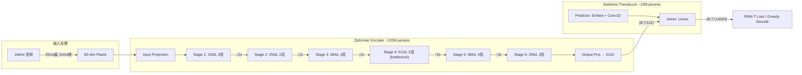

# Real-ASR: 构音障碍实时语音识别系统

基于 Qwen3-ASR 知识蒸馏的轻量级流式 ASR 模型，专为构音障碍 (Dysarthria) 语音设计。

---

## 项目概述

构音障碍患者的语音具有高度变异性（发音不稳定、语速异常、元辅音失真），对 ASR 系统提出了极大挑战。本项目通过对微调后的 Qwen3-ASR-1.7B 进行知识蒸馏，训练出一个 ~150M 参数的实时流式模型，可在本地 GPU 上低延迟运行。

### 核心特点

- **构音障碍适配**: 针对构音障碍语音特征设计的数据增强和 curriculum learning
- **知识蒸馏**: 从 1.7B teacher 蒸馏为 150M student，保留大部分识别能力
- **实时流式**: Zipformer + Stateless Transducer, < 400ms 端到端延迟
- **本地部署**: 仅需 2GB GPU 显存，RTX 3060 即可运行

### 架构对比

| 指标 | Teacher (Qwen3-ASR-1.7B) | Student (Zipformer 150M) |
|------|--------------------------|--------------------------|
| 模型大小 | 6.8 GB (FP16) | 300 MB (FP16) / 150 MB (INT8) |
| 参数量 | 1.7B | ~150M |
| GPU 显存 | 24 GB+ | 2 GB |
| 流式延迟 | ~500ms (2s chunk) | ~370ms (320ms chunk) |
| 推理速度 | 0.05 RTF (A100) | < 0.01 RTF (RTX 3060) |
| CER (构音障碍) | < 15% | 17-20% (预期) |

---

## 模型详细架构

### 整体结构

模型采用 **Zipformer Encoder + Stateless Transducer** 架构，整体数据流如下：



---

### Zipformer Encoder 详解

Zipformer 是一个**多尺度 U-Net 结构**的语音编码器，在不同时间分辨率上处理声学信息：

```
输入 Fbank (100 Hz, 即每秒 100 帧)
    │
    ▼
┌─────────────────────────────────────────┐
│ Stage 1: dim=192, heads=4, layers=2     │  ← 100 Hz (原始分辨率)
│         Conv kernel=31, FFN=512         │
└────────────────┬────────────────────────┘
                 │ Downsample 2x (Conv1d stride=2)
                 ▼
┌─────────────────────────────────────────┐
│ Stage 2: dim=256, heads=4, layers=2     │  ← 50 Hz
│         Conv kernel=31, FFN=768         │
└────────────────┬────────────────────────┘
                 │ Downsample 2x
                 ▼
┌─────────────────────────────────────────┐
│ Stage 3: dim=384, heads=8, layers=4     │  ← 25 Hz
│         Conv kernel=31, FFN=1536        │
└────────────────┬────────────────────────┘
                 │ Downsample 2x
                 ▼
┌─────────────────────────────────────────┐
│ Stage 4: dim=512, heads=8, layers=5     │  ← 12.5 Hz (bottleneck)
│         Conv kernel=31, FFN=2048        │  ← 最多计算量集中在这里
└────────────────┬────────────────────────┘
                 │ Upsample 2x (ConvTranspose1d)
                 ▼
┌─────────────────────────────────────────┐
│ Stage 5: dim=384, heads=8, layers=4     │  ← 25 Hz
│         Conv kernel=31, FFN=1536        │  ← + Skip connection from Stage 3
└────────────────┬────────────────────────┘
                 │ Upsample 2x
                 ▼
┌─────────────────────────────────────────┐
│ Stage 6: dim=256, heads=4, layers=2     │  ← 50 Hz
│         Conv kernel=31, FFN=768         │  ← + Skip connection from Stage 2
└────────────────┬────────────────────────┘
                 │ Output Projection (Linear 256→512)
                 ▼
         Encoder 输出: (batch, T, 512)
```

**每个 Stage 内部 (ZipformerBlock):**

```
Input x
  │
  ├──→ 0.5 × FeedForward1 (LayerNorm → Linear → SiLU → Linear)
  │         ↓
  ├──→ Self-Attention (Multi-head, chunked mask)
  │         ↓
  ├──→ Convolution Module:
  │       LayerNorm → Pointwise Conv (GLU gate)
  │       → Depthwise Conv (kernel=31) → BatchNorm → SiLU
  │       → Pointwise Conv
  │         ↓
  ├──→ 0.5 × FeedForward2
  │         ↓
  └──→ LayerNorm → Output
```

**为什么选 Zipformer 而非 Conformer:**
- U-Net 多尺度结构：高层低分辨率处理长距离依赖，低层高分辨率保留细节
- 中间层降采样大幅减少计算量（bottleneck 只有 12.5Hz）
- 相同参数量下精度优于 Conformer

---

### 流式推理机制 (Chunked Attention)

在流式模式下，Self-Attention 不能看到未来的全部帧。通过 **chunk mask** 限制注意力范围：

```
         chunk_size = 32 帧 (320ms)
         left_context = 64 帧 (640ms)
         right_context = 8 帧 (80ms)

时间轴: ──────────────────────────────────────────────→

     |← left 64 →|← chunk 32 →|← right 8 →|
     ■■■■■■■■■■■■ ████████████ ▒▒▒▒▒▒▒▒
                   ↑ 当前帧可以看到的范围

每 320ms 输出一次结果，延迟 = 320ms chunk + 80ms 右上下文 = 400ms 算法延迟
```

对构音障碍语音，保留 8 帧右上下文很有意义——因为不清晰的发音往往需要后续音素来辅助判断。

---

### Stateless Predictor (代替 LSTM)

传统 RNN-T 的 Predictor 用 LSTM 建模文本历史，推理时需要维护隐状态，速度慢。

本项目使用 **Stateless Predictor**:

```
已输出 token 历史: [..., t_{n-2}, t_{n-1}]
                        ↓
              Embedding Lookup (dim=512)
                        ↓
              Conv1D × 2 (kernel=3, 残差连接)
                        ↓
              Linear Projection + LayerNorm
                        ↓
              Predictor 输出: (batch, U, 512)
```

- 只看最近 2 个 token (context_size=2)，无需维护 hidden state
- 推理时本质是一个查表 + 卷积操作，极快
- 对构音障碍足够：识别主要靠声学信息，语言模型上下文需求不大

---

### Joiner (融合 Encoder + Predictor)

Joiner 是 RNN-T 的核心——在 (时间 T, 标签 U) 的每个网格点上预测下一个 token:

```
Encoder 输出: (B, T, 512) → Linear → (B, T, 1, 512)    广播
                                              ↘
                                         tanh(enc + pred)
                                              ↗         ↓
Predictor 输出: (B, U, 512) → Linear → (B, 1, U, 512)  Linear → (B, T, U, 6000)
                                广播                         ↓
                                                     Softmax → 预测 token
```

输出是一个 (T × U × Vocab) 的 lattice，训练时用 **Pruned RNN-T Loss** (k2 实现) 高效计算。

---

### CTC 辅助 Head

Encoder 输出额外接一个线性层做 CTC 预测，用途：
1. **训练**: 辅助 loss 稳定 encoder 收敛
2. **蒸馏**: 逐帧与 teacher 的 soft target 对齐 (KL divergence)
3. **推理** (可选): CTC prefix beam search + Transducer rescoring

```
Encoder 输出 (B, T, 512) → Linear (512 → 6000) → Log-Softmax → CTC 概率
```

---

### 参数量统计

| 组件 | 参数量 | 占比 |
|------|--------|------|
| Zipformer Encoder (6 stages) | ~118M | 79% |
| Input/Output Projection | ~1.5M | 1% |
| Stateless Predictor | ~10M | 7% |
| Joiner | ~6M | 4% |
| CTC Head | ~3M | 2% |
| KD Projection Layer (仅训练时) | ~0.5M | - |
| **总计 (推理时)** | **~138M** | 100% |

---

### 与 Teacher (Qwen3-ASR-1.7B) 架构对比

| | Teacher (Qwen3-ASR) | Student (本项目) |
|--|---------------------|-----------------|
| Encoder | AuT (Attention Encoder-Decoder), 300M, 24层, dim=1024 | Zipformer, ~118M, 6 stages (19层), max dim=512 |
| Decoder | Qwen3-1.7B LLM (28层 Transformer, dim=2048) | Stateless Predictor (~10M, 无 autoregressive) |
| 解码方式 | Autoregressive token-by-token | RNN-T greedy / beam search |
| 帧率 | 12.5 Hz (8x downsample from Fbank) | 50-100 Hz (取决于 stage) |
| 流式 | Dynamic flash attention window 1-8s | Chunked attention 320ms |
| 为什么更快 | - | 无 LLM 自回归，无 KV cache，纯前向传播 |

---

## 项目结构

```
real-asr/
├── configs/                    # 配置文件
│   ├── model.yaml              # 模型架构配置
│   ├── train_stage1.yaml       # Stage 1: 通用预训练
│   ├── train_stage2.yaml       # Stage 2: 知识蒸馏
│   └── train_stage3.yaml       # Stage 3: 有监督微调
├── data/                       # 数据处理
│   ├── prepare_dysarthric.py   # 构音障碍数据 → Lhotse 格式
│   ├── pseudo_label.py         # Teacher 伪标签生成
│   ├── filter.py               # 伪标签质量过滤
│   ├── augment.py              # 构音障碍特化数据增强
│   └── dataset.py              # PyTorch Dataset 和 Sampler
├── model/                      # 模型定义
│   ├── zipformer.py            # Zipformer 流式 Encoder
│   ├── transducer.py           # Stateless Predictor + Joiner
│   ├── ctc_head.py             # 辅助 CTC Head
│   └── distill_wrapper.py     # 蒸馏训练包装器
├── train/                      # 训练脚本
│   ├── train.py                # 统一训练入口 (Stage 1 & 3)
│   ├── distill.py              # Stage 2 蒸馏训练
│   └── curriculum.py           # Severity-aware 课程学习
├── export/                     # 模型导出
│   └── export_onnx.py          # ONNX 导出 (encoder/predictor/joiner)
├── serve/                      # 推理服务
│   └── streaming_server.py     # WebSocket 流式 ASR 服务
├── requirements.txt
└── README.md
```

---

## 环境配置

### 系统要求

- Python 3.10+
- CUDA 12.1+ (训练) / CUDA 11.8+ (推理)
- GPU: 训练建议 4× A100 80GB; 推理仅需 RTX 3060 6GB

### 安装

```bash
# 克隆项目
git clone https://github.com/chen-ming-yang/real-asr.git
cd real-asr

# 创建环境
conda create -n real-asr python=3.10
conda activate real-asr

# 安装依赖
pip install -r requirements.txt

# 安装 k2 (需与 PyTorch/CUDA 版本匹配)
# 参考: https://k2-fsa.github.io/k2/installation/index.html
pip install k2==1.24.4.dev20240725+cuda12.4.torch2.4.0 -f https://k2-fsa.github.io/k2/cuda.html
```

---

## 训练流程

### 0. 数据准备

#### 构音障碍标注数据

准备好你的构音障碍标注数据，目录结构如下：

```
/path/to/dysarthric_data/
├── wavs/                    # 16kHz mono WAV 文件
│   ├── spk001_001.wav
│   ├── spk001_002.wav
│   └── ...
├── transcripts.json         # {"spk001_001": "你好世界", ...}
└── severity.json            # {"spk001": "moderate", ...} (可选)
```

转为 Lhotse JSONL 格式:

```bash
python data/prepare_dysarthric.py \
    --data-dir /path/to/dysarthric_data \
    --output-dir data/manifests/dysarthric \
    --severity-map /path/to/dysarthric_data/severity.json
```

#### 伪标签生成 (可选，用于扩展数据)

对额外无标注的构音障碍音频，用 teacher 模型生成伪标签:

```bash
python data/pseudo_label.py \
    --model-path /path/to/finetuned_qwen3_asr \
    --audio-dir /path/to/unlabeled_audio \
    --output-dir data/manifests/pseudo_labeled \
    --batch-size 32 \
    --num-gpus 1
```

#### 伪标签过滤

```bash
python data/filter.py \
    --input-dir data/manifests/pseudo_labeled \
    --output-dir data/manifests/pseudo_labeled_filtered \
    --min-char-rate 0.5 \
    --max-char-rate 12.0
```

#### 数据增强 (可选)

```bash
python data/augment.py \
    --input-dir data/manifests/dysarthric \
    --output-dir data/augmented \
    --config configs/train_stage3.yaml \
    --num-copies 3
```

---

### 1. Stage 1: 通用中文预训练

在 WenetSpeech 等大规模中文数据上预训练学生模型的基础声学能力:

```bash
# 先用原始 Qwen3-ASR 对 WenetSpeech 生成 pseudo-label
python data/pseudo_label.py \
    --model-path Qwen/Qwen3-ASR-1.7B \
    --audio-dir /path/to/wenetspeech/audio \
    --output-dir data/manifests/wenetspeech

# 预训练 (4 GPUs)
torchrun --nproc_per_node=4 train/train.py \
    --config configs/train_stage1.yaml
```

**预计时长**: 10000h 数据, 4×A100, ~3-5 天

---

### 2. Stage 2: 构音障碍知识蒸馏

用微调后的 Qwen3-ASR teacher 对学生模型进行蒸馏:

```bash
# 修改 configs/train_stage2.yaml 中的 teacher.model_path
# 指向你微调后的 Qwen3-ASR checkpoint

torchrun --nproc_per_node=4 train/distill.py \
    --config configs/train_stage2.yaml
```

蒸馏包含两种知识迁移:
- **Feature-level KD**: 对齐 student encoder 输出与 teacher AuT encoder 输出
- **Output-level KD**: 用 teacher 的 token probability 作为 soft target

**预计时长**: 构音障碍数据 + pseudo-label, 4×A100, ~2-3 天

---

### 3. Stage 3: 有监督微调

在真实标注数据上微调，使用 severity-aware curriculum learning:

```bash
torchrun --nproc_per_node=4 train/train.py \
    --config configs/train_stage3.yaml
```

Curriculum 策略:
1. Epoch 1-5: 仅轻度 (mild) 构音障碍
2. Epoch 6-10: 轻度 + 中度 (moderate)
3. Epoch 11-15: 全部严重程度
4. Epoch 16-20: 全部，降低学习率

**预计时长**: 100-500h 标注数据, 4×A100, ~1 天

---

## 模型导出与部署

### ONNX 导出

```bash
python export/export_onnx.py \
    --checkpoint exp/stage3_finetune/epoch_20.pt \
    --config configs/model.yaml \
    --output-dir exported_models \
    --verify
```

导出结果:
```
exported_models/
├── encoder.onnx       # Zipformer encoder (~400 MB)
├── predictor.onnx     # Stateless predictor (~40 MB)
├── joiner.onnx        # Joiner (~10 MB)
└── tokenizer_config.json
```

### 启动流式推理服务

```bash
python serve/streaming_server.py \
    --model-dir exported_models \
    --port 6006 \
    --device cuda \
    --chunk-ms 320
```

### WebSocket 客户端示例

```python
import asyncio
import json
import websockets
import numpy as np
import soundfile as sf

async def transcribe(audio_path: str, server_url: str = "ws://localhost:6006"):
    audio, sr = sf.read(audio_path)
    if sr != 16000:
        # resample to 16kHz
        import librosa
        audio = librosa.resample(audio, orig_sr=sr, target_sr=16000)

    async with websockets.connect(server_url) as ws:
        # Send audio in chunks (320ms)
        chunk_size = int(16000 * 0.32)
        for i in range(0, len(audio), chunk_size):
            chunk = audio[i:i + chunk_size]
            pcm = (chunk * 32768).astype(np.int16).tobytes()
            await ws.send(pcm)

            response = await ws.recv()
            result = json.loads(response)
            if result["text"]:
                print(f"[{'FINAL' if result['is_final'] else 'partial'}] {result['text']}")

asyncio.run(transcribe("test.wav"))
```

---

## 配置说明

### model.yaml 关键参数

| 参数 | 含义 | 推荐值 |
|------|------|--------|
| `encoder.num_stages` | Zipformer U-Net 阶段数 | 6 |
| `encoder.hidden_dims` | 各阶段隐藏维度 | [192, 256, 384, 512, 384, 256] |
| `encoder.chunk_size` | 流式 chunk 大小 (帧数) | 32 (= 320ms) |
| `encoder.right_context_frames` | 右上下文帧数 | 8 |
| `predictor.embedding_dim` | Predictor 维度 | 512 |
| `predictor.context_size` | 历史 token 数 | 2 |
| `joiner.output_dim` | 词汇表大小 | 6000 |

### 训练超参建议

| 阶段 | 学习率 | Epochs | Batch (duration/s) |
|------|--------|--------|-------------------|
| Stage 1 (预训练) | 0.045 | 25 | 600 |
| Stage 2 (蒸馏) | 0.01 | 40 | 400 |
| Stage 3 (微调) | 0.003 | 20 | 500 |

---

## 构音障碍特化设计

### 数据增强策略

| 增强方法 | 参数范围 | 目的 |
|----------|----------|------|
| Speaking Rate | 0.7x - 1.3x | 适应构音障碍语速变化大的特点 |
| Pitch Shift | ±3 半音 | 模拟声带控制不稳定 |
| Formant Perturb | ±10% | 模拟构音器官运动不精确 |
| SpecAugment | freq=27, time=100ms | 提升鲁棒性 |
| Noise (MUSAN) | SNR 5-20 dB | 环境噪声鲁棒 |

### 伪标签过滤阈值 (与正常语音对比)

| 参数 | 正常语音 | 构音障碍 | 原因 |
|------|----------|----------|------|
| min_char_rate | 1.0 字/s | 0.5 字/s | 构音障碍语速慢 |
| max_char_rate | 15 字/s | 12 字/s | 不会特别快 |
| max_char_repeat | 3 | 5 | 重复可能是真实口吃 |
| max_word_repeat | 3 | 4 | 同上 |

### Severity-aware Curriculum

构音障碍按严重程度分三级:
- **Mild**: 发音基本清晰，偶尔模糊
- **Moderate**: 部分音节不清，语速减慢
- **Severe**: 大部分发音严重变形，语速很慢

从 mild → severe 逐步训练有助于模型建立稳定的声学表征。

---

## TensorBoard 监控

```bash
tensorboard --logdir exp/ --port 6007
```

关键指标:
- `train/loss_total`: 总训练损失
- `train/loss_rnnt`: RNN-T 损失
- `train/loss_ctc`: CTC 辅助损失
- `distill/feat_kd`: Feature-level 蒸馏损失
- `distill/out_kd`: Output-level 蒸馏损失

---

## 常见问题

### Q: 模型精度不够，如何提升？

1. 增加 teacher pseudo-label 数据量（更多无标注构音障碍音频）
2. 使用 Zipformer-Large (150M) 而非 Medium (80M)
3. 增加 Stage 2 蒸馏轮数
4. 尝试更大的 right_context_frames (如 16) 提升识别质量

### Q: 推理延迟如何进一步降低？

1. 减小 chunk_size 到 16 frames (160ms)，精度会略降
2. 使用 INT8 量化 (ONNX Runtime quantize_dynamic)
3. 使用 Zipformer-Medium (80M)

### Q: 如何适配新的构音障碍类型？

1. 收集目标类型的标注数据 (哪怕只有几十小时)
2. 直接跑 Stage 3 微调，从当前 checkpoint 继续
3. 如有该类型的无标注数据，也可跑一轮 Stage 2 蒸馏

### Q: 如何增加新的语言支持？

当前模型仅支持中文。如需多语言:
1. 扩展词汇表 (增加目标语言字符/BPE)
2. Stage 1 加入目标语言通用数据
3. 收集目标语言的构音障碍数据做 Stage 3

---

## 引用与参考

- [Qwen3-ASR Technical Report](https://arxiv.org/abs/2601.21337)
- [Zipformer: A faster and better encoder for automatic speech recognition](https://arxiv.org/abs/2310.11230)
- [Delayed-KD: Delayed Knowledge Distillation based CTC for Low-Latency Streaming ASR](https://arxiv.org/abs/2505.22069)
- [Hierarchical Curriculum Learning for Dysarthric Speech Recognition](https://doi.org/10.1109/taslpro.2025.3597438)
- [k2-fsa/icefall](https://github.com/k2-fsa/icefall)
- [sherpa-onnx](https://github.com/k2-fsa/sherpa-onnx)

---

## License

This project is released under the **Apache License 2.0**. See [LICENSE](LICENSE).

It includes code from icefall (Xiaomi Corp., Apache-2.0) and is distilled from
Qwen3-ASR (Apache-2.0). See [NOTICE](NOTICE) for details.
